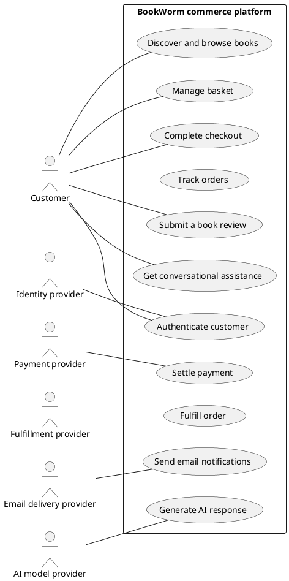

BookWorm is an online bookstore and commerce platform. It helps customers discover books, build a basket, submit a purchase, and use supporting capabilities such as order lifecycle management, reviews, and conversational assistance.

This architecture describes the complete platform as a portfolio of business capabilities and their interactions. It complements the detailed domain, system, service, contract, flow, and operational documentation in the catalog; it does not replace those sources of implementation detail.

## Business purpose and drivers

The primary business goal is to provide a dependable online bookstore experience, not merely to publish a list of products. The architecture must support:

- finding books and accessing authoritative product information;
- creating a purchase from the customer's persisted basket and current catalog information;
- handing an accepted purchase to the capability that owns the order lifecycle;
- supporting customer feedback and book-related assistance without transferring ownership of product or order data.

These drivers require the platform to preserve the meaning and ownership of data as it moves between independently responsible capabilities. For example, [[domain|catalog]] remains authoritative for book facts, while [[domain|ordering]] owns an [[entity|order]] after checkout acceptance.

## System scope

The system under consideration includes these [[domain|BookWorm]] capabilities:

- **[[domain|catalog]]** owns book information, pricing, and availability.
- **[[domain|shopping]]** owns the [[entity|basket]] and checkout experience.
- **[[domain|ordering]]** owns an [[entity|order]]'s lifecycle after acceptance.
- **[[domain|reviews]]** owns customer [[entity|feedback]] associated with books.
- **[[domain|conversational]]** provides book discovery and store-assistance experiences.
- **[[domain|platform]]** supplies shared capabilities such as scheduled processing and email notification delivery.

The platform integrates with systems and providers for identity ([[system|identity-provider]]), payment settlement, shipping execution, email delivery ([[system|sendgrid]]), and AI model hosting. Those neighbors and their interfaces matter to BookWorm, but their internal business logic and operations are outside this system's scope. Their relationships to BookWorm are described in [[doc|arc42/03-context-and-scope]] and in the relevant system documentation.

The following use case diagram summarizes BookWorm's principal customer-facing goals and external system interactions. It is a high-level view, not a workflow or interface specification:

## Intended audience

This chapter is for customers and business stakeholders seeking to understand the platform's purpose, engineers who need to preserve context ownership and contract boundaries, and platform, operations, and architecture teams who make or support system-wide decisions. [[doc|arc42/01-introduction-and-goals/004-stakeholders]] summarizes their specific concerns.

## Architectural boundary

BookWorm is documented as cooperating bounded contexts, not as one shared business model. Cross-context interactions must respect the owning context's contracts; shared platform infrastructure can enable business capabilities but does not take ownership of their business data. This boundary is central to the requirements in [[doc|arc42/01-introduction-and-goals/002-requirements-overview]] and the constraints in [[doc|arc42/02-architecture-constraints]].
