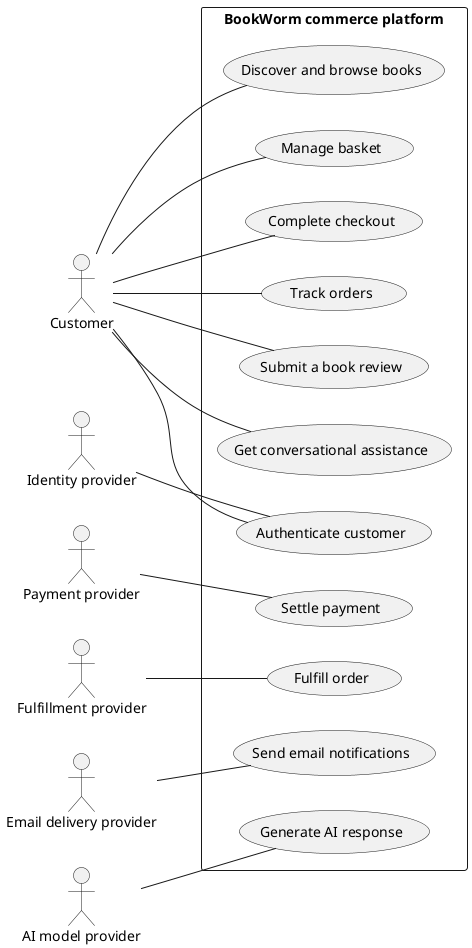

## 1. Context & Problem

BookWorm is an online bookstore and commerce platform designed to deliver a dependable end-to-end shopping experience—not merely a static list of products. Customers need to discover books, build a basket, submit a purchase, track their orders, share reviews, and receive conversational assistance.

Supporting all of those activities inside a single, undifferentiated business model creates a common architectural problem: as capabilities grow, data ownership blurs, rules overlap, and a change in one area unexpectedly breaks another. BookWorm therefore organizes its platform as a portfolio of cooperating capabilities where each area retains clear ownership of its business meaning and data—for example, book facts remain authoritative in [[domain|catalog]], while [[domain|ordering]] takes ownership of an [[entity|order]] only after checkout acceptance.

This introduction sets the high-level business purpose, capability boundaries, and external scope for the entire platform. It complements—rather than replaces—the detailed domain, service, contract, flow, and operational entries in the catalog.

## 2. Business Value

- **Dependable customer journey**: Shoppers browse authoritative book information and pricing, check out using their saved basket, and receive clear accountability for accepted orders, reviews, and assistance.
- **Clear organizational ownership**: Each capability area owns its business rules and records, reducing cross-team friction and limiting the blast radius when requirements evolve.
- **Clean external boundaries**: Relying on specialized external providers for identity, payment settlement, shipping fulfillment, email delivery, and AI model hosting keeps commodity operations outside BookWorm's core business scope.
- **Shared alignment across roles**: Gives business stakeholders, product managers, analysts, architects, and engineers a common baseline before diving into detailed service or contract specifications.

## 3. How It Works

The [[domain|BookWorm]] platform divides responsibilities across six focused business and enabling capabilities:

- **[[domain|catalog]]**: Serves as the authoritative source for book information, pricing, and availability.
- **[[domain|shopping]]**: Manages the customer's persisted [[entity|basket]] and guides the checkout experience using current Catalog information.
- **[[domain|ordering]]**: Assumes ownership of an [[entity|order]]'s lifecycle and fulfillment tracking once a purchase is accepted at checkout.
- **[[domain|reviews]]**: Captures and displays customer [[entity|feedback]] linked to books without taking over ownership of Catalog product data.
- **[[domain|conversational]]**: Provides book discovery and store-assistance experiences grounded in Catalog information, without assuming ownership of product or order records.
- **[[domain|platform]]**: Supplies shared supporting capabilities—such as scheduled background processing and email notification delivery—without altering or owning business state belonging to other capabilities.

Around this core, BookWorm integrates with external systems and providers for customer authentication, payment settlement, physical order fulfillment, email delivery, and AI response generation. Their internal business logic and operations remain outside BookWorm's system boundary.

The following high-level use case diagram summarizes BookWorm's principal customer-facing goals and external system interactions:

## 4. Trade-offs & Lessons Learned

- **Bounded contexts over a shared business model**: Keeping capabilities separate prevents hidden data coupling and protects business invariants, at the cost of requiring explicit agreements and disciplined handoffs whenever two capabilities interact.
- **Enabling platform vs. business owner**: Shared utilities such as scheduling and email delivery must remain strictly supporting infrastructure. Allowing shared utilities to take ownership of business rules or state creates bottlenecks and obscures accountability.
- **External partner boundaries**: Delegating identity, payments, fulfillment, email, and AI hosting speeds delivery of core commerce features, while requiring BookWorm to treat those neighbors strictly through their external boundaries rather than relying on their internal operations.
- **Audience and scope**: Business stakeholders use this view to align on scope, engineers use it to preserve ownership and contract boundaries, and operations and architecture teams use it to guide cross-cutting decisions (see [[doc|arc42/01-introduction-and-goals/004-stakeholders]]).

## 5. Technical Reference

- **Internal BookWorm domains and core entities**:
  - Platform root: [[domain|BookWorm]]
  - Product truth: [[domain|catalog]]
  - Basket & checkout: [[domain|shopping]] (owns [[entity|basket]])
  - Order lifecycle: [[domain|ordering]] (owns [[entity|order]])
  - Customer reviews: [[domain|reviews]] (owns [[entity|feedback]])
  - Assistance: [[domain|conversational]]
  - Shared platform services: [[domain|platform]]
- **External systems referenced in the catalog**:
  - Identity provider: [[system|identity-provider]]
  - Email delivery provider: [[system|sendgrid]]
  - Additional neighbors (payment settlement, fulfillment execution, and AI model hosting) are mapped at the system boundary in [[doc|arc42/03-context-and-scope]].
- **Related arc42 documentation**:
  - Essential requirements: [[doc|arc42/01-introduction-and-goals/002-requirements-overview]]
  - Stakeholder roles and concerns: [[doc|arc42/01-introduction-and-goals/004-stakeholders]]
  - Architecture constraints: [[doc|arc42/02-architecture-constraints]]
  - System context and neighbors: [[doc|arc42/03-context-and-scope]]
