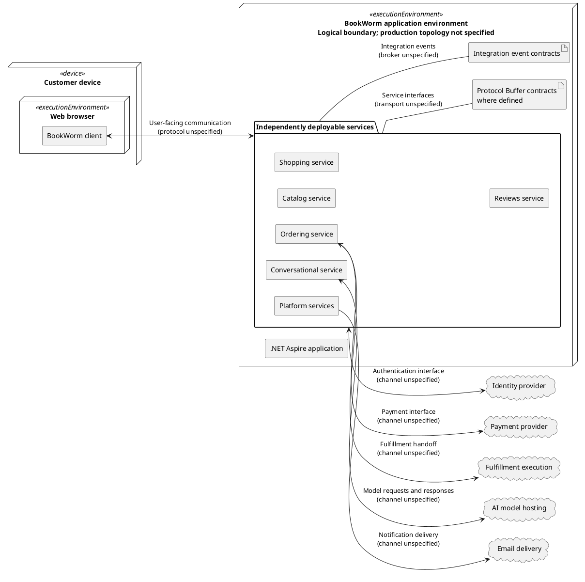

The platform is documented as a service-oriented application using .NET Aspire and independently deployable services. The technical context below separates those internal boundaries from neighboring systems and distinguishes known communication mechanisms from details that are not established in the available architecture sources.

## Technical neighbors and mechanisms

| Neighbor or mechanism                    | Relationship and known interaction                                                       | Details not established here                                            |
| ---------------------------------------- | ---------------------------------------------------------------------------------------- | ----------------------------------------------------------------------- |
| User-facing clients                      | Initiate customer journeys and consume platform capabilities                             | Complete client inventory, protocols, and endpoint definitions          |
| Independently deployable services        | Implement platform capabilities and interact through owned contracts                     | Complete service topology and all pairwise interactions                 |
| Integration messaging                    | Carries integration events between capabilities                                          | Broker, transport, event schemas, routing, and delivery guarantees      |
| Protocol Buffer interfaces               | Used for defined service communication contracts                                         | Which interfaces use them and their endpoint or transport configuration |
| Identity provider                        | Supports authentication and token verification                                           | Provider, protocol, and deployment arrangement                          |
| Payment provider                         | Supports payment settlement                                                              | Provider, protocol, and transaction details                             |
| Fulfillment, email, and AI model hosting | External capabilities used for fulfillment, notifications, and conversational assistance | Provider inventory, protocols, and operational guarantees               |
| Shared platform infrastructure           | Supplies cross-cutting capabilities; .NET Aspire is part of the documented platform      | Full component inventory and production deployment topology             |

## Business interface to technical channel

| Business interaction                                                   | Technical realization documented so far                                                                     |
| ---------------------------------------------------------------------- | ----------------------------------------------------------------------------------------------------------- |
| Customer search, shopping, ordering, reviews, and assistance           | User-facing clients call platform capabilities; exact channels and protocols are not specified              |
| Communication between service capabilities                             | Explicit service contracts, including Protocol Buffers where defined                                        |
| Cross-capability integration                                           | Integration events; broker and event-level details are not specified                                        |
| Authentication, payment, fulfillment, notification, and model requests | Neighboring-system interfaces exist at the conceptual level; their channels and protocols are not specified |

## Technical operating model

BookWorm's technical context is structured around service boundaries rather than a single shared business component. Explicit contracts and integration events support communication across those boundaries, while shared infrastructure provides cross-cutting capabilities such as notifications and scheduling. Protocol Buffers are used for defined service interfaces; their use should not be assumed for every interaction.

The repository-level sources do not establish a complete external-system inventory, network topology, or production deployment view. Document those details in the relevant service and operational entries as interfaces are confirmed.
