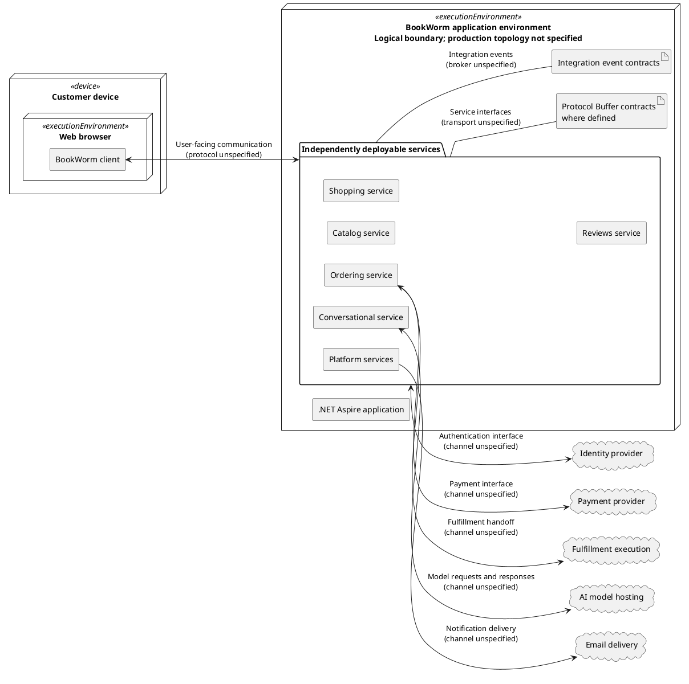

BookWorm is structured around independently deployable capabilities rather than a single shared business component. This page maps the high-level technical boundaries between user-facing applications, internal capabilities, and neighboring systems, while clearly distinguishing confirmed mechanisms from details that remain open.

## 1. Context & Problem

Once stakeholders agree on the business exchanges at BookWorm's boundary, teams need a clear picture of how those interactions are realized technically—without inventing or assuming deployment layouts, vendor protocols, or infrastructure choices that have not been decided. Making both the known communication patterns and the open technical questions explicit keeps architecture aligned with reality.

## 2. Business Value

- **Independent capability delivery:** Organizing the platform into separately deployable capabilities lets teams build, test, and evolve domains with minimal interference.
- **Controlled external dependencies:** Isolating identity, payment, fulfillment, email, and AI model interactions at clear boundaries protects core commerce logic from external provider churn.
- **Honest risk visibility:** Explicitly flagging undecided transport channels, delivery guarantees, and deployment topologies prevents teams from building brittle assumptions into schedules or designs.

## 3. How It Works

At a high level, BookWorm separates how customers access the store from how internal capabilities collaborate and how external partners are reached:

1. **Customer access:** Customers interact through a web-based storefront that initiates product discovery, shopping, ordering, reviews, and conversational support journeys.
2. **Modular internal capabilities:** Behind the storefront, BookWorm separates Catalog, Shopping, Ordering, Reviews, Conversational assistance, and shared Platform capabilities (such as notifications and scheduling) instead of lumping all business rules into one component.
3. **Structured internal communication:** Capabilities collaborate across boundaries through two primary mechanisms—explicit service agreements for direct capability calls, and business notifications (integration events) for cross-capability updates.
4. **External partner boundaries:** Specialized responsibilities—authentication ([[system|identity-provider]]), payment settlement, order fulfillment, email delivery ([[system|sendgrid]]), and AI model hosting—sit outside BookWorm's boundary as conceptual partner interfaces whose concrete providers and channels are finalized per capability.

## 4. Trade-offs & Lessons Learned

- **Modular boundaries vs. coordination effort:** Splitting the platform into independently deployable services avoids single-component bottlenecks, but introduces cross-service contracts and messaging that require explicit ownership and testing.
- **Targeted standardization vs. blanket rules:** Standardized structured contracts are used for defined service interfaces rather than forced onto every interaction, balancing consistency with flexibility—teams should never assume every call uses the same mechanism.
- **Deferring topology and broker specifics:** Repository-level sources intentionally do not prescribe a complete external-system inventory, network layout, messaging broker, delivery guarantees, or production deployment view; those belong in dedicated service and operational documentation as interfaces are confirmed.

## 5. Technical Reference

The platform is documented as a service-oriented application using .NET Aspire and independently deployable services. The diagram and tables below separate internal boundaries from neighboring systems and distinguish known communication mechanisms from details not established in the available architecture sources.

### Technical Neighbors and Mechanisms

| Neighbor or mechanism                                           | Relationship and known interaction                                                       | Details not established here                                            |
| --------------------------------------------------------------- | ---------------------------------------------------------------------------------------- | ----------------------------------------------------------------------- |
| User-facing clients                                             | Initiate customer journeys and consume platform capabilities                             | Complete client inventory, protocols, and endpoint definitions          |
| Independently deployable services                               | Implement platform capabilities and interact through owned contracts                     | Complete service topology and all pairwise interactions                 |
| Integration messaging                                           | Carries integration events between capabilities                                          | Broker, transport, event schemas, routing, and delivery guarantees      |
| Protocol Buffer interfaces                                      | Used for defined service communication contracts                                         | Which interfaces use them and their endpoint or transport configuration |
| Identity provider ([[system\|identity-provider]])               | Supports authentication and token verification                                           | Provider, protocol, and deployment arrangement                          |
| Payment provider                                                | Supports payment settlement                                                              | Provider, protocol, and transaction details                             |
| Fulfillment, email ([[system\|sendgrid]]), and AI model hosting | External capabilities used for fulfillment, notifications, and conversational assistance | Provider inventory, protocols, and operational guarantees               |
| Shared platform infrastructure                                  | Supplies cross-cutting capabilities; .NET Aspire is part of the documented platform      | Full component inventory and production deployment topology             |

### Business Interface to Technical Channel

| Business interaction                                                   | Technical realization documented so far                                                                     |
| ---------------------------------------------------------------------- | ----------------------------------------------------------------------------------------------------------- |
| Customer search, shopping, ordering, reviews, and assistance           | User-facing clients call platform capabilities; exact channels and protocols are not specified              |
| Communication between service capabilities                             | Explicit service contracts, including Protocol Buffers where defined                                        |
| Cross-capability integration                                           | Integration events; broker and event-level details are not specified                                        |
| Authentication, payment, fulfillment, notification, and model requests | Neighboring-system interfaces exist at the conceptual level; their channels and protocols are not specified |

### Technical Operating Model Notes

- BookWorm's technical context is structured around service boundaries rather than a single shared business component.
- Explicit contracts and integration events support communication across those boundaries, while shared infrastructure provides cross-cutting capabilities such as notifications and scheduling.
- Protocol Buffers are used for defined service interfaces; their use should not be assumed for every interaction.
- The repository-level sources do not establish a complete external-system inventory, network topology, or production deployment view. Document those details in the relevant service and operational entries as interfaces are confirmed.
