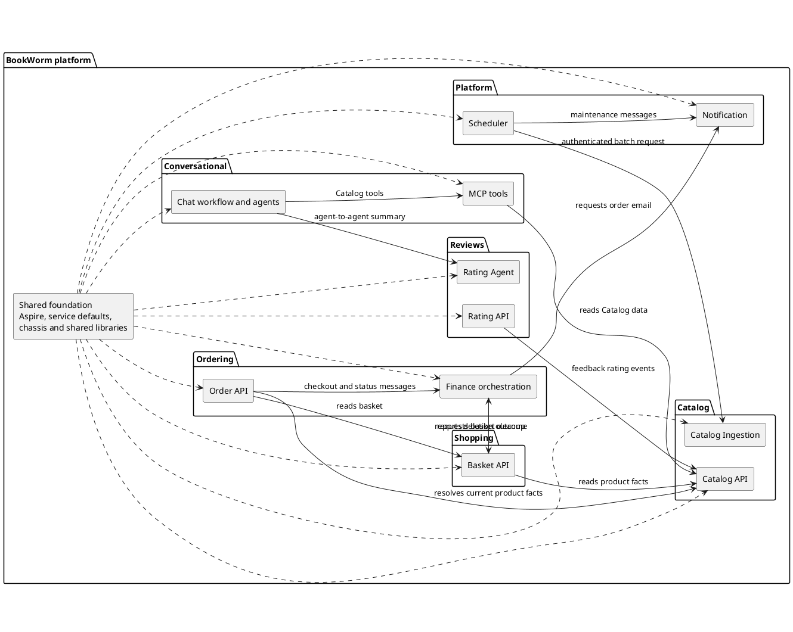

The system under consideration is the complete BookWorm commerce platform. The diagram shows its major building blocks and the principal dependencies between them. External actors and provider boundaries are covered in [[doc|arc42/03-context-and-scope]].

### Overview diagram

### Detailed service and data-store diagram

The following view complements the capability-level overview with service
dependencies, communication paths, and persistence components.

<DrawIO url="https://viewer.diagrams.net/?tags=%7B%7D&lightbox=1&target=blank&highlight=0000ff&layers=1&nav=1&title=BookWorm&dark=0#Uhttps%3A%2F%2Fdrive.google.com%2Fuc%3Fid%3D14OKRv9-iGiyCvOu4qwSnh1Mk6e5f_XWg%26export%3Ddownload" />

### Decomposition rationale

BookWorm is decomposed by bounded context and business ownership, not by technical layer alone. Each capability owns its business rules and data; communication across capabilities uses service contracts and integration messages. This structure lets a capability change internally while keeping its consumers insulated by those contracts.

The shared foundation supports service startup and common technical concerns. It is not a shared business layer and does not own Catalog, Basket, Order, or Feedback data.

### Contained building blocks

| Building block             | Responsibility                                                                                                                                                                   | Main interfaces and dependencies                                                                                                                              | Source mapping (`BookWorm/src/`)                                                         |
| -------------------------- | -------------------------------------------------------------------------------------------------------------------------------------------------------------------------------- | ------------------------------------------------------------------------------------------------------------------------------------------------------------- | ---------------------------------------------------------------------------------------- |
| [[domain\|catalog]]        | Owns book and reference data, pricing, availability, discovery, and the derived book-rating projection.                                                                          | [[service\|catalog-api]]; Catalog integration events; [[service\|catalog-ingestion]] processes queued search-index updates.                                   | `Services/Catalog/BookWorm.Catalog/`, `Services/Catalog/BookWorm.Catalog.Ingestion/`     |
| [[domain\|shopping]]       | Owns customer baskets and pre-order shopping state. It retrieves current Catalog facts for basket presentation and supports checkout cleanup.                                    | [[service\|basket-api]]; reads Catalog data; exchanges checkout and deletion outcomes with Ordering's coordination workflow.                                  | `Services/Basket/BookWorm.Basket/`                                                       |
| [[domain\|ordering]]       | Owns accepted Orders, purchase-time item values, and Order status. Its coordination service handles post-checkout work without taking ownership of Basket or Notification state. | [[service\|order-api]], [[service\|order-orchestration]]; checkout and status events; Basket cleanup outcomes; notification commands.                         | `Services/Ordering/BookWorm.Ordering/`, `Services/Finance/BookWorm.Finance/`             |
| [[domain\|reviews]]        | Owns individual customer Feedback and produces read-time review summaries. Catalog consumes rating changes and maintains its own derived rating projection.                      | [[service\|rating-api]]; feedback integration events; read-only Catalog and feedback tools for [[agent\|rating-agent]].                                       | `Services/Rating/BookWorm.Rating/`                                                       |
| [[domain\|conversational]] | Provides the customer-facing conversational workflow and specialist agents for support and Catalog-backed discovery.                                                             | [[service\|chat-api]]; MCP access through [[system\|mcp-tools]]; A2A access to the Rating agent; privacy processing through Presidio.                         | `Services/Chat/BookWorm.Chat/`, `Services/McpTools/BookWorm.McpTools/`                   |
| [[domain\|platform]]       | Provides durable notifications and scheduled processing without owning the business state handled by other capabilities.                                                         | [[service\|notification-api]]; Quartz schedules and authenticated Catalog Ingestion requests, plus maintenance messages from [[service\|sheduler-dashboard]]. | `Services/Notification/BookWorm.Notification/`, `Services/Scheduler/BookWorm.Scheduler/` |
| **Shared foundation**      | Supplies service hosting, common runtime configuration, and reusable technical building blocks.                                                                                  | Aspire AppHost and service defaults; reusable chassis, constants, shared-kernel, and Presidio hosting libraries.                                              | `Aspire/`, `BuildingBlocks/`, `Integrations/`                                            |

### Important interfaces

- Order API reads Basket and current Catalog facts during checkout. These reads do not transfer ownership of either capability's data.
- Order API publishes checkout and Order status messages to Finance. Finance owns coordination state; Ordering continues to own Order status.
- Finance requests Basket cleanup and receives its outcome through service contracts. A deletion result is not proof that an Order completed.
- Reviews publishes Feedback changes for Catalog to update its own rating projection; Catalog does not read the Rating Database.
- Conversational uses scoped MCP tools for Catalog information and an agent-to-agent interface for Rating summaries. The workflow does not place Orders, mutate Baskets, or publish commerce lifecycle events.
- Scheduler invokes Catalog Ingestion through an authenticated service request and publishes maintenance messages for Notification. The receiving service owns processing and its outcome.
- Platform services own their operational state, such as schedules and email outbox records, but do not determine the business outcome of the work they schedule or notify.
