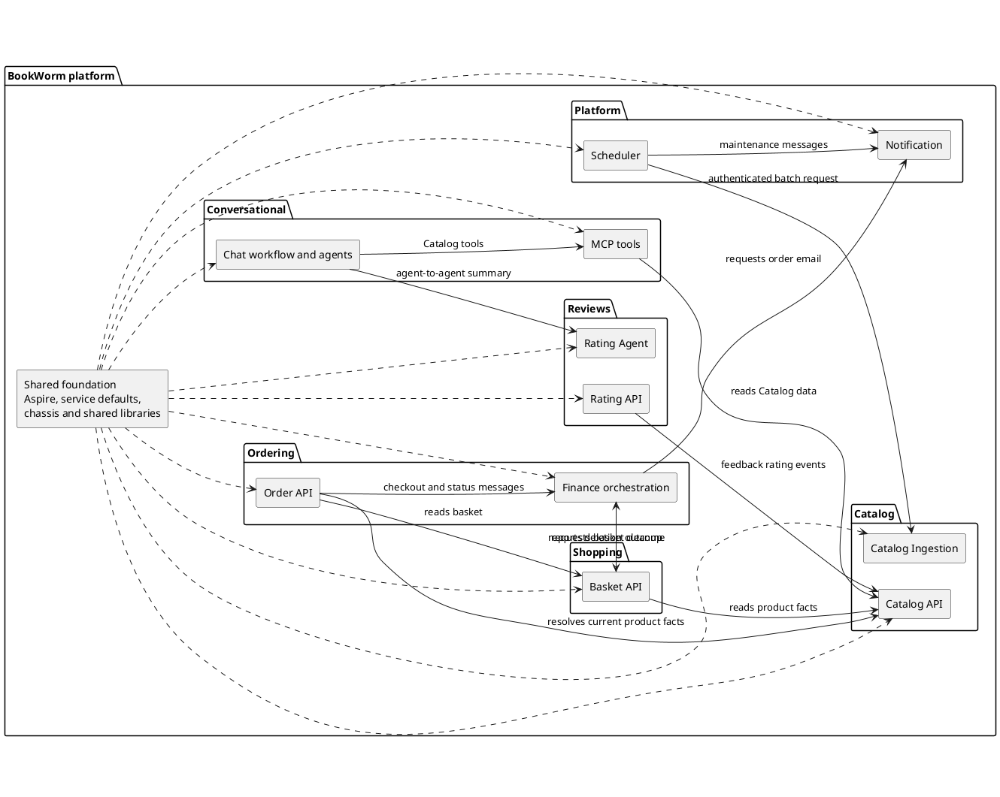

## 1. Context & Problem

While external actors and provider boundaries are mapped in [[doc|arc42/03-context-and-scope]], stakeholders also need to see what sits inside the BookWorm platform itself. In a commerce system spanning product discovery, baskets, orders, reviews, conversational assistance, and background operations, splitting components along technical layers alone often creates a shared middle tier where everyone edits the same rules and data.

This Level-1 white-box view breaks BookWorm into owned business capabilities and shows the primary dependencies between them so every team knows what each part owns and how capabilities collaborate.

## 2. Business Value

- **Clear business accountability:** Each capability owns its domain rules and records, making it straightforward to assign feature work, triage defects, and measure impact.
- **Insulated evolution:** Capabilities interact through explicit contracts and business announcements rather than shared internal state, allowing internal improvements without breaking neighboring capabilities.
- **Safe conversational assistance:** Customer-facing AI support enhances discovery and review comprehension without risking unauthorized order placement or basket changes.

## 3. How It Works

BookWorm is organized around six business capabilities supported by a common technical foundation. The shared foundation supplies startup configuration and common technical plumbing, but it is **not** a shared business layer and never owns product, basket, order, or review data.

- **Catalog** ([[domain|catalog]]) owns book details, reference data, pricing, availability, discovery, and aggregated book ratings, along with background updates to keep search results current.
- **Shopping** ([[domain|shopping]]) owns active customer baskets before checkout, reads current book details from Catalog for display, and removes submitted baskets when requested after checkout.
- **Ordering** ([[domain|ordering]]) owns accepted orders, purchase-time item values, and official order status. A dedicated coordination component manages post-checkout follow-up—such as requesting basket cleanup and order emails—without taking ownership of baskets or notifications.
- **Reviews** ([[domain|reviews]]) owns individual customer feedback and produces read-time review summaries. It announces rating changes so Catalog can maintain its own rating totals without reading Review records directly.
- **Conversational** ([[domain|conversational]]) delivers interactive customer support and book discovery through specialist assistants, scoped Catalog lookups, privacy filtering, and Review summaries. It is strictly advisory and never places orders, changes baskets, or triggers commerce lifecycle changes.
- **Platform** ([[domain|platform]]) provides durable notifications and recurring scheduled work. It tracks operational attempts (schedules and delivery records) while leaving business outcomes to the originating capability.

### Key boundary rules

- Reading basket contents and current book facts at checkout does not transfer ownership of either capability's data to Ordering.
- Ordering hands off checkout and status updates to its coordination component, which owns coordination progress while Ordering keeps ownership of official order status.
- Successful basket cleanup only confirms that the basket was deleted—it does not prove an order is complete.
- Catalog updates its derived book ratings from feedback announcements rather than reading Reviews storage directly.
- Conversational workflows remain read-only/advisory with respect to commerce transactions.
- Scheduled triggers and email processing record operational execution, while the receiving capability owns processing and business meaning.

## 4. Trade-offs & Lessons Learned

- **Clear ownership vs. extra boundary messaging:** Keeping basket deletion, order status, coordination state, and notification delivery in separate capabilities requires explicit handoffs and outcome messages, but prevents tangled state across domains.
- **Derived projections over cross-domain queries:** Having Catalog maintain its own rating projection from Review announcements avoids runtime database coupling, at the cost of handling asynchronous updates.
- **Strict guardrails on AI workflows:** Keeping conversational tools read-only and advisory avoids complex transactional compensation from chat interactions, while requiring users to complete purchases through the standard shopping and checkout path.
- **Operational success is not business completion:** Distinguishing operational records (scheduled runs, notification outbox records) from business status ensures failures are diagnosed in the right capability without misreporting order outcomes.

## 5. Technical Reference

### Overview diagram

### Detailed service and data-store diagram

The following view complements the capability-level overview with service dependencies, communication paths, and persistence components.

<DrawIO url="https://viewer.diagrams.net/?tags=%7B%7D&lightbox=1&target=blank&highlight=0000ff&layers=1&nav=1&title=BookWorm&dark=0#Uhttps%3A%2F%2Fdrive.google.com%2Fuc%3Fid%3D14OKRv9-iGiyCvOu4qwSnh1Mk6e5f_XWg%26export%3Ddownload" />

### Decomposition rationale

BookWorm is decomposed by bounded context and business ownership, not by technical layer alone. Each capability owns its business rules and data; communication across capabilities uses service contracts and integration messages. This structure lets a capability change internally while keeping its consumers insulated by those contracts.

The shared foundation supports service startup and common technical concerns. It is not a shared business layer and does not own Catalog, Basket, Order, or Feedback data.

### Contained building blocks

| Building block             | Responsibility                                                                                                                                                                   | Main interfaces and dependencies                                                                                                                              | Source mapping (`BookWorm/src/`)                                                         |
| -------------------------- | -------------------------------------------------------------------------------------------------------------------------------------------------------------------------------- | ------------------------------------------------------------------------------------------------------------------------------------------------------------- | ---------------------------------------------------------------------------------------- |
| [[domain\|catalog]]        | Owns book and reference data, pricing, availability, discovery, and the derived book-rating projection.                                                                          | [[service\|catalog-api]]; Catalog integration events; [[service\|catalog-ingestion]] processes queued search-index updates.                                   | `Services/Catalog/BookWorm.Catalog/`, `Services/Catalog/BookWorm.Catalog.Ingestion/`     |
| [[domain\|shopping]]       | Owns customer baskets and pre-order shopping state. It retrieves current Catalog facts for basket presentation and supports checkout cleanup.                                    | [[service\|basket-api]]; reads Catalog data; exchanges checkout and deletion outcomes with Ordering's coordination workflow.                                  | `Services/Basket/BookWorm.Basket/`                                                       |
| [[domain\|ordering]]       | Owns accepted Orders, purchase-time item values, and Order status. Its coordination service handles post-checkout work without taking ownership of Basket or Notification state. | [[service\|order-api]], [[service\|order-orchestration]]; checkout and status events; Basket cleanup outcomes; notification commands.                         | `Services/Ordering/BookWorm.Ordering/`, `Services/Finance/BookWorm.Finance/`             |
| [[domain\|reviews]]        | Owns individual customer Feedback and produces read-time review summaries. Catalog consumes rating changes and maintains its own derived rating projection.                      | [[service\|rating-api]]; feedback integration events; read-only Catalog and feedback tools for [[agent\|rating-agent]].                                       | `Services/Rating/BookWorm.Rating/`                                                       |
| [[domain\|conversational]] | Provides the customer-facing conversational workflow and specialist agents for support and Catalog-backed discovery.                                                             | [[service\|chat-api]]; MCP access through [[system\|mcp-tools]]; A2A access to the Rating agent; privacy processing through Presidio.                         | `Services/Chat/BookWorm.Chat/`, `Services/McpTools/BookWorm.McpTools/`                   |
| [[domain\|platform]]       | Provides durable notifications and scheduled processing without owning the business state handled by other capabilities.                                                         | [[service\|notification-api]]; Quartz schedules and authenticated Catalog Ingestion requests, plus maintenance messages from [[service\|sheduler-dashboard]]. | `Services/Notification/BookWorm.Notification/`, `Services/Scheduler/BookWorm.Scheduler/` |
| **Shared foundation**      | Supplies service hosting, common runtime configuration, and reusable technical building blocks.                                                                                  | Aspire AppHost and service defaults; reusable chassis, constants, shared-kernel, and Presidio hosting libraries.                                              | `Aspire/`, `BuildingBlocks/`, `Integrations/`                                            |

### Important interfaces

- Order API reads Basket and current Catalog facts during checkout. These reads do not transfer ownership of either capability's data.
- Order API publishes checkout and Order status messages to Finance. Finance owns coordination state; Ordering continues to own Order status.
- Finance requests Basket cleanup and receives its outcome through service contracts. A deletion result is not proof that an Order completed.
- Reviews publishes Feedback changes for Catalog to update its own rating projection; Catalog does not read the Rating Database.
- Conversational uses scoped MCP tools for Catalog information and an agent-to-agent interface for Rating summaries. The workflow does not place Orders, mutate Baskets, or publish commerce lifecycle events.
- Scheduler invokes Catalog Ingestion through an authenticated service request and publishes maintenance messages for Notification. The receiving service owns processing and its outcome.
- Platform services own their operational state, such as schedules and email outbox records, but do not determine the business outcome of the work they schedule or notify.
