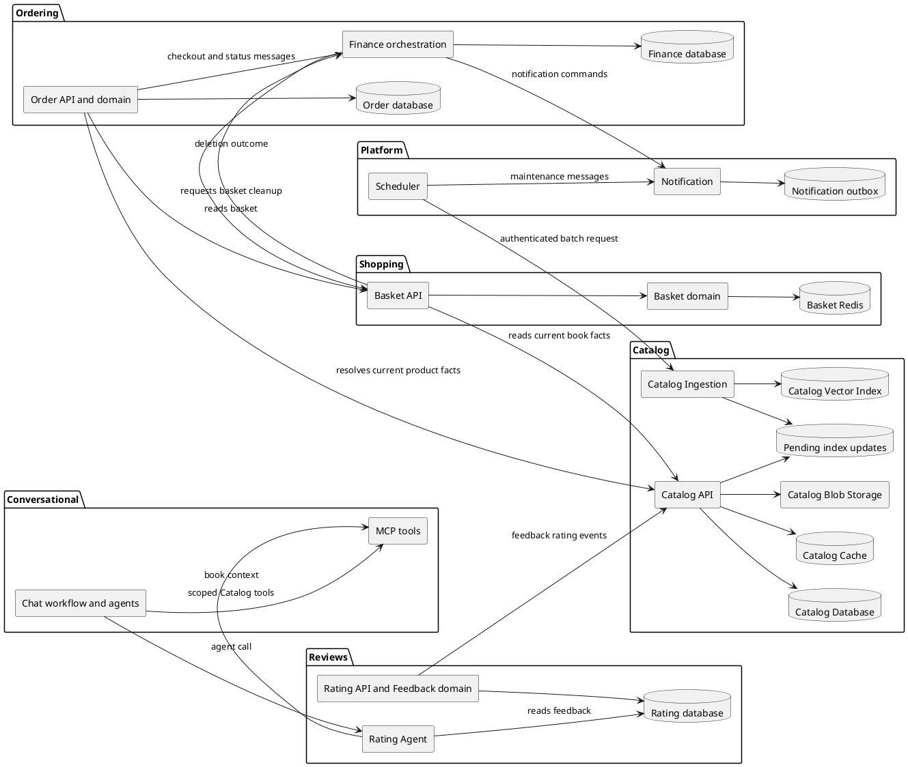

This level refines the Level-1 capabilities where distinct data ownership, asynchronous coordination, or multiple internal modules make the structure useful to understand. It omits routine framework internals.

### Overview diagram

### 5.2.1 White box: Catalog

**Purpose.** Catalog owns book and reference data and supplies product discovery to the rest of BookWorm. It also maintains its own derived average-rating and review-count fields from Reviews events.

| Internal building block                       | Responsibility                                                                                                                                                                                                                     | Main source location                                                                                                                  |
| --------------------------------------------- | ---------------------------------------------------------------------------------------------------------------------------------------------------------------------------------------------------------------------------------- | ------------------------------------------------------------------------------------------------------------------------------------- |
| **Catalog API**                               | [[service\|catalog-api]] validates and serves book, author, category, and publisher operations; provides HTTP and gRPC interfaces; coordinates persistence, selected cached reads, image storage, and search.                      | `Services/Catalog/BookWorm.Catalog/` (`Features/`, `Domain/`, `Grpc/`, `Infrastructure/`, `IntegrationEvents/`)                       |
| **Catalog persistence and supporting stores** | [[container\|catalog-database]] is authoritative for catalog entities and pending vector work. Cache, Blob Storage, and the vector index support reads, image bytes, and search; they are not substitutes for canonical book data. | `domains/BookWorm/subdomains/Catalog/systems/product-catalog-system/containers/`; `Services/Catalog/BookWorm.Catalog/Infrastructure/` |
| **Catalog Ingestion**                         | [[service\|catalog-ingestion]] processes queued book updates, builds searchable representations, and updates or removes records in the vector index. Catalog retains responsibility for the queue and ingestion acknowledgment.    | `Services/Catalog/BookWorm.Catalog.Ingestion/`                                                                                        |

The API and ingestion worker are separate service projects. A Catalog write can therefore succeed while its derived search index is still catching up; the database remains the source of truth.

### 5.2.2 White box: Shopping

**Purpose.** Shopping owns the customer's mutable Basket before an Order is accepted. It uses Catalog facts for item presentation but does not own product data or accepted Orders.

| Internal building block                | Responsibility                                                                                                                                                                          | Main source location                                                    |
| -------------------------------------- | --------------------------------------------------------------------------------------------------------------------------------------------------------------------------------------- | ----------------------------------------------------------------------- |
| **Basket API**                         | [[service\|basket-api]] handles authenticated basket creation, retrieval, replacement, and deletion over HTTP and gRPC.                                                                 | `Services/Basket/BookWorm.Basket/` (`Features/`, `Grpc/`)               |
| **Basket domain**                      | Enforces basket and item behavior, including the customer-scoped basket contents and quantity rules.                                                                                    | `Services/Basket/BookWorm.Basket/Domain/`                               |
| **Basket persistence and integration** | [[container\|basket-database]] stores active basket state in Redis; Basket reads Catalog data for presentation and reports checkout cleanup outcomes through its integration contracts. | `Services/Basket/BookWorm.Basket/Infrastructure/`, `IntegrationEvents/` |

Checkout cleanup is an explicit lifecycle operation. A successful Basket deletion does not mean that the Order is complete; Ordering remains authoritative for Order status.

### 5.2.3 White box: Ordering

**Purpose.** Ordering owns accepted Orders, the purchase-time values captured for their items, and the business status of each Order. The Order API and Finance coordination service are separate projects because they own different state and responsibilities.

| Internal building block         | Responsibility                                                                                                                                                                                                                               | Main source location                                                                                                           |
| ------------------------------- | -------------------------------------------------------------------------------------------------------------------------------------------------------------------------------------------------------------------------------------------- | ------------------------------------------------------------------------------------------------------------------------------ |
| **Order API and domain**        | [[service\|order-api]] creates and manages Orders and Buyer records, resolves Basket and Catalog information during checkout, and owns Order status.                                                                                         | `Services/Ordering/BookWorm.Ordering/` (`Features/`, `Domain/`, `Grpc/`, `IntegrationEvents/`)                                 |
| **Order persistence and cache** | [[container\|order-database]] stores the authoritative Order state and supports selected Order reads. Neither is shared with the Basket or Catalog data stores.                                                                              | `domains/BookWorm/subdomains/Ordering/systems/order-system/containers/`; `Services/Ordering/BookWorm.Ordering/Infrastructure/` |
| **Finance orchestration**       | [[service\|order-orchestration]] persists a checkout saga, requests Basket cleanup, handles its result, and publishes commands that request order notifications. It does not own the Order's business status or Notification delivery state. | `Services/Finance/BookWorm.Finance/` (`Saga/`, `Constracts/`, `Infrastructure/`)                                               |
| **Finance persistence**         | [[container\|finance-database]] stores saga and message-envelope state used by the coordination workflow.                                                                                                                                    | `domains/BookWorm/subdomains/Ordering/systems/finance-system/containers/`; `Services/Finance/BookWorm.Finance/Infrastructure/` |

The principal boundary is ownership: Order API records the Order, Basket handles its own deletion, Finance records coordination progress, and Notification owns email processing.

### 5.2.4 White box: Reviews

**Purpose.** Reviews owns individual customer Feedback and provides retrieval and read-time summarization. Catalog consumes rating changes and owns the resulting book-level projection.

| Internal building block            | Responsibility                                                                                                                                                   | Main source location                                                                                                                       |
| ---------------------------------- | ---------------------------------------------------------------------------------------------------------------------------------------------------------------- | ------------------------------------------------------------------------------------------------------------------------------------------ |
| **Rating API and Feedback domain** | [[service\|rating-api]] creates, lists, and deletes Feedback and serves summary requests.                                                                        | `Services/Rating/BookWorm.Rating/` (`Features/`, `Domain/`, `IntegrationEvents/`)                                                          |
| **Rating persistence**             | [[container\|rating-database]] stores the authoritative individual Feedback records.                                                                             | `domains/BookWorm/subdomains/Reviews/systems/rating-system/containers/rating-database/`; `Services/Rating/BookWorm.Rating/Infrastructure/` |
| **Rating Agent**                   | [[agent\|rating-agent]] produces a derived, read-only review summary using current book context and stored reviews. It does not change Feedback or Catalog data. | `Services/Rating/BookWorm.Rating/Agents/`, `Tools/`, `Policies/`                                                                           |

Feedback-created and feedback-deleted messages let Catalog maintain its rating projection without reading the Rating Database. A failure to apply a rating is handled through the documented compensating integration path.

### 5.2.5 White box: Conversational

**Purpose.** Conversational provides interactive support and book discovery through a composed workflow and specialist agents. Its agents use tools and delegated agent interfaces rather than owning Catalog or Reviews records.

| Internal building block      | Responsibility                                                                                                                               | Main source location                                                                      |
| ---------------------------- | -------------------------------------------------------------------------------------------------------------------------------------------- | ----------------------------------------------------------------------------------------- |
| **Chat workflow and agents** | [[service\|chat-api]] hosts request orchestration, validation and response formatting, and specialist Router, QA, Book, and research agents. | `Services/Chat/BookWorm.Chat/` (`Orchestration/`, `Agents/`, `Policies/`, `Skills/`)      |
| **MCP tools service**        | [[system\|mcp-tools]] provides reusable, explicitly scoped tools and resources, including Catalog-backed book lookups.                       | `Services/McpTools/BookWorm.McpTools/` (`Tools/`, `Resources/`, `Services/`)              |
| **Privacy integration**      | Applies the configured PII analysis and anonymization path through the Presidio integration.                                                 | `Integrations/BookWorm.Hosting.Presidio/`; `BuildingBlocks/BookWorm.Chassis/AI/Presidio/` |

Chat can call the Rating-hosted agent through its agent-to-agent interface. This is separate from the MCP path to Catalog tools. The conversational workflow is advisory: it does not place Orders, mutate Baskets, or publish commerce lifecycle events.

### 5.2.6 White box: Platform

**Purpose.** Platform provides recurring-job coordination and notification delivery. Each service owns its operational state; the target business system remains responsible for the meaning and outcome of the work.

| Internal building block      | Responsibility                                                                                                                                                                                 | Main source location                                                                                              |
| ---------------------------- | ---------------------------------------------------------------------------------------------------------------------------------------------------------------------------------------------- | ----------------------------------------------------------------------------------------------------------------- |
| **Scheduler**                | [[service\|sheduler-dashboard]] persists Quartz schedules and execution state, runs jobs, invokes authenticated work in Catalog Ingestion, and publishes maintenance messages to Notification. | `Services/Scheduler/BookWorm.Scheduler/` (`Jobs/`, `Clients/`, `IntegrationEvents/`)                              |
| **Notification**             | [[service\|notification-api]] consumes order notification commands, renders messages, persists email work in an outbox, and submits email through SMTP.                                        | `Services/Notification/BookWorm.Notification/` (`Domain/`, `Templates/`, `IntegrationEvents/`, `Infrastructure/`) |
| **Scheduler persistence**    | [[container\|sheduler-database]] stores schedules, triggers, and job execution state; it is not Catalog or Notification business data.                                                         | `domains/BookWorm/subdomains/Platform/systems/scheduler-system/containers/`                                       |
| **Notification persistence** | [[container\|notification-database]] stores email outbox records and delivery state.                                                                                                           | `domains/BookWorm/subdomains/Platform/systems/notification-system/containers/`                                    |

Scheduler records that work was attempted; Catalog Ingestion and Notification own processing and their respective outcomes. Provider acceptance of an SMTP submission is not proof of final recipient delivery or business completion.

### 5.2.7 Shared technical foundation

These modules are reused by service hosts and support implementation consistency. They are not additional business capabilities and should not be treated as shared mutable domain logic.

| Building block                   | Responsibility                                                                                                  | Source location                                                               |
| -------------------------------- | --------------------------------------------------------------------------------------------------------------- | ----------------------------------------------------------------------------- |
| **Aspire AppHost**               | Composes the local/cloud-native application host and service projects.                                          | `Aspire/BookWorm.AppHost/`                                                    |
| **Service Defaults**             | Supplies common host configuration, including service defaults and Kestrel extensions.                          | `Aspire/BookWorm.ServiceDefaults/`                                            |
| **Chassis**                      | Holds reusable technical components such as endpoints, event bus, persistence helpers, logging, and telemetry.  | `BuildingBlocks/BookWorm.Chassis/`                                            |
| **Constants and Shared Kernel**  | Holds shared technical constants and small common primitives; domain ownership remains with the owning service. | `BuildingBlocks/BookWorm.Constants/`, `BuildingBlocks/BookWorm.SharedKernel/` |
| **Presidio hosting integration** | Hosts reusable integration support for the external PII service.                                                | `Integrations/BookWorm.Hosting.Presidio/`                                     |
