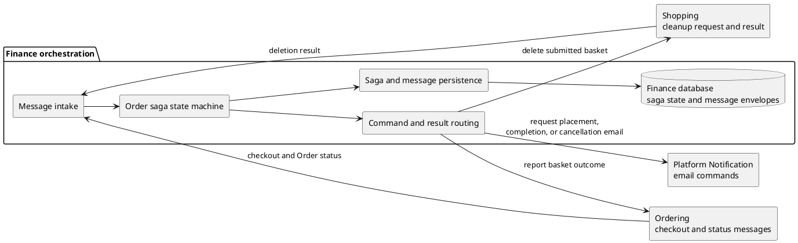

## 1. Context & Problem

Completing a customer checkout involves multiple independent capabilities: Ordering accepts and owns the order, Shopping must clear the customer's basket, and Platform Notification must send lifecycle emails. Embedding cross-capability follow-up logic directly inside Ordering or Shopping would blur responsibilities and tangle business rules with workflow tracking.

To keep those boundaries clean, BookWorm isolates post-checkout coordination in the [[service|order-orchestration]] building block (Finance orchestration). This Level-3 view opens that coordination component to show its internal parts and how they interact with neighboring capabilities without duplicating step-by-step runtime sequences.

## 2. Business Value

- **Reliable post-checkout follow-through:** Tracks every order's coordination progress individually so basket cleanup and email notifications happen consistently across service boundaries.
- **Clean business ownership:** Keeps Ordering focused on order truth, Shopping focused on basket state, and Notification focused on email delivery.
- **Centralized resilience:** Manages workflow timeouts and retry policies in one dedicated coordination component instead of repeating coordination logic across services.

## 3. How It Works

Finance orchestration acts as a dedicated coordinator for each order after checkout:

1. **Starts tracking at checkout:** When Ordering announces an order checkout, Finance opens a coordination record linked to that specific order.
2. **Requests basket cleanup:** Finance asks Shopping to remove the submitted basket and waits for an explicit success or failure result, then reports that outcome back to Ordering.
3. **Requests lifecycle emails:** As checkout and order status updates arrive—and when recipient details are available—Finance asks Platform Notification to send placement, completion, or cancellation emails.
4. **Respects authority boundaries:** Throughout the workflow, Finance stores only its own coordination progress. Ordering remains the authority for order status, Shopping remains the authority for basket contents, and Notification remains the authority for email rendering and delivery.

## 4. Trade-offs & Lessons Learned

- **Coordination timeouts do not cancel orders:** A timeout or cancellation inside Finance reflects a coordination outcome only—it never automatically cancels the customer's order in Ordering.
- **Requesting a notification does not prove delivery:** Publishing an email request confirms that Finance handed off the instruction, while Notification owns rendering and actual delivery tracking.
- **Dedicated coordination store vs. embedded logic:** Maintaining a separate coordination component and data store adds an operational component to manage, but keeps cross-service workflow state out of core order and basket domains.
- **Structural clarity without contract duplication:** Concrete message definitions, retry settings, and failure scenarios are maintained in the Finance system and flow documentation so this structural view stays focused on boundaries.

## 5. Technical Reference

This level refines the Level-2 [[service|order-orchestration]] building block, whose persisted saga coordinates checkout outcomes across Ordering, Shopping, and Platform Notification. It describes Finance's internal building blocks and the contracts at its boundary; it is not a runtime sequence.

### 5.3.1 White box: Finance orchestration

Finance is refined to Level 3 because its persisted saga coordinates checkout outcomes across Ordering, Shopping, and Platform Notification.

#### Overview diagram

**Purpose.** Finance consumes checkout and Order-status messages, records coordination state for each Order, requests Basket cleanup, handles cleanup outcomes, and requests lifecycle notifications. It owns saga state, not Order status, Basket contents, or email delivery state.

| Internal building block                    | Responsibility                                                                                                                                          | Main source location                                                                       |
| ------------------------------------------ | ------------------------------------------------------------------------------------------------------------------------------------------------------- | ------------------------------------------------------------------------------------------ |
| **Saga state machine**                     | Correlates workflow state by Order ID, tracks Basket cleanup and Order lifecycle outcomes, and applies configured timeout and retry behavior.           | [[service\|order-orchestration]] (`Saga/`)                                                 |
| **Finance message contracts**              | Defines the messages consumed from Ordering and the commands/results exchanged with Ordering, Shopping, and Notification.                               | `Services/Finance/BookWorm.Finance/Constracts/`                                            |
| **Message and persistence infrastructure** | Connects the saga to the message transport and persists saga and message-envelope state.                                                                | `Services/Finance/BookWorm.Finance/Infrastructure/`                                        |
| **Finance database**                       | [[container\|finance-database]] stores Finance-owned saga state and message persistence; it is not the system of record for Orders, Baskets, or emails. | `domains/BookWorm/subdomains/Ordering/systems/finance-system/containers/finance-database/` |

#### Internal relationships

1. Finance message contracts provide the input and output types used by the saga and its service integrations.
2. The saga state machine interprets checkout, Basket-deletion, and Order-status messages and updates its own correlated workflow state.
3. Message infrastructure routes outgoing requests and results and persists the saga and message envelopes in the Finance database.
4. Ordering remains authoritative for Order status; Shopping remains authoritative for Basket contents; Notification remains authoritative for email rendering and delivery state.

#### Important interface behavior

- An Order checkout event starts a Finance saga correlated to that Order.
- Finance asks Shopping to delete the submitted Basket and handles the explicit success or failure result.
- Finance emits notification commands for placement, completion, or cancellation where recipient details are available; command publication does not prove delivery.
- A Finance timeout or saga cancellation is a coordination outcome, not by itself an Order cancellation.

The concrete message names, retry settings, and failure cases are maintained in the Finance system and flow documentation so this structural view does not duplicate their contract definitions.
