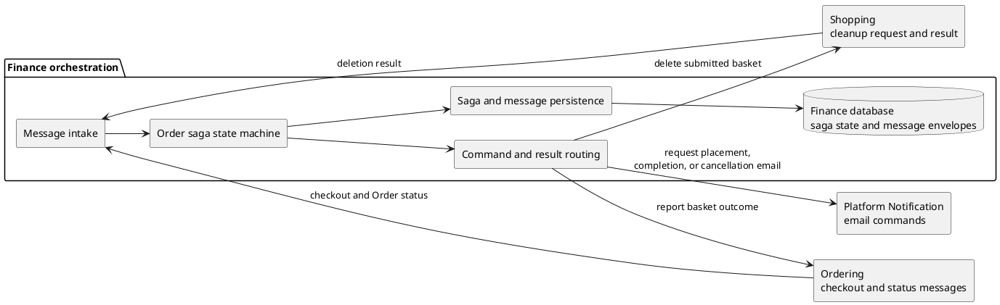

This level refines the Level-2 [[service|order-orchestration]] building block, whose persisted saga coordinates checkout outcomes across Ordering, Shopping, and Platform Notification. It describes Finance's internal building blocks and the contracts at its boundary; it is not a runtime sequence.

### 5.3.1 White box: Finance orchestration

Finance is refined to Level 3 because its persisted saga coordinates checkout outcomes across Ordering, Shopping, and Platform Notification.

#### Overview diagram

**Purpose.** Finance consumes checkout and Order-status messages, records coordination state for each Order, requests Basket cleanup, handles cleanup outcomes, and requests lifecycle notifications. It owns saga state, not Order status, Basket contents, or email delivery state.

| Internal building block                    | Responsibility                                                                                                                                          | Main source location                                                                       |
| ------------------------------------------ | ------------------------------------------------------------------------------------------------------------------------------------------------------- | ------------------------------------------------------------------------------------------ |
| **Saga state machine**                     | Correlates workflow state by Order ID, tracks Basket cleanup and Order lifecycle outcomes, and applies configured timeout and retry behavior.           | [[service\|order-orchestration]] (`Saga/`)                                                 |
| **Finance message contracts**              | Defines the messages consumed from Ordering and the commands/results exchanged with Ordering, Shopping, and Notification.                               | `Services/Finance/BookWorm.Finance/Constracts/`                                            |
| **Message and persistence infrastructure** | Connects the saga to the message transport and persists saga and message-envelope state.                                                                | `Services/Finance/BookWorm.Finance/Infrastructure/`                                        |
| **Finance database**                       | [[container\|finance-database]] stores Finance-owned saga state and message persistence; it is not the system of record for Orders, Baskets, or emails. | `domains/BookWorm/subdomains/Ordering/systems/finance-system/containers/finance-database/` |

#### Internal relationships

1. Finance message contracts provide the input and output types used by the saga and its service integrations.
2. The saga state machine interprets checkout, Basket-deletion, and Order-status messages and updates its own correlated workflow state.
3. Message infrastructure routes outgoing requests and results and persists the saga and message envelopes in the Finance database.
4. Ordering remains authoritative for Order status; Shopping remains authoritative for Basket contents; Notification remains authoritative for email rendering and delivery state.

#### Important interface behavior

- An Order checkout event starts a Finance saga correlated to that Order.
- Finance asks Shopping to delete the submitted Basket and handles the explicit success or failure result.
- Finance emits notification commands for placement, completion, or cancellation where recipient details are available; command publication does not prove delivery.
- A Finance timeout or saga cancellation is a coordination outcome, not by itself an Order cancellation.

The concrete message names, retry settings, and failure cases are maintained in the Finance system and flow documentation so this structural view does not duplicate their contract definitions.
