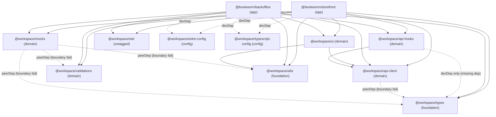

# BookWorm Frontend Architecture & Code Review

> **Scope**: `src/Clients` (`@bookworm/storefront`, `@bookworm/backoffice`, and 10 `@workspace/*` packages)
> **Baseline**: Bun `1.4.4`, Node `v26.13.0`, Turborepo `2.11.13`, Next.js `16.4.6` (Turbopack, `output: "standalone"`), React `19.3.1`, TypeScript `^6.0.3` / `@typescript/native` (`tsgo`).

---

## 1. Architecture Summary & Dependency Diagram

BookWorm's frontend is a Bun + Turborepo monorepo containing two Next.js 16 App Router applications and ten internal workspace packages:

- **Apps (`tag: app`)**:
  - `@bookworm/storefront`: Customer-facing store (RSC + Client Components, Jotai + TanStack Query, Better Auth + Entra ID, CopilotKit AI chat, Tailwind v4).
  - `@bookworm/backoffice`: Admin portal served under `basePath: "/backoffice"` (TanStack Query + TanStack Table + Recharts, Better Auth + Entra ID, Tailwind v4).
- **Domain Packages (`tag: domain`)**: `@workspace/api-client`, `@workspace/api-hooks`, `@workspace/validations`, `@workspace/ui`, `@workspace/mocks`.
- **Foundation Packages (`tag: foundation`)**: `@workspace/types`, `@workspace/utils`.
- **Config Packages (`tag: config`)**: `@workspace/eslint-config`, `@workspace/typescript-config`.
- **Untagged Package**: `@workspace/otel` (missing `turbo.json` and `check-types` script).

### Baseline Checks

| Check | Result | Timing | Key Notes |
|---|---|---|---|
| `bun run boundaries` | **FAILED** (exit 1) | ~8s | 53 issues across 593 files (`@workspace/mocks`, `@workspace/api-client`, `@workspace/api-hooks` import `@workspace/*` via `peerDependencies` / `devDependencies` instead of `dependencies`) |
| `bun run check-types` | **PASSED** (9/9) | 2.14s (73ms cached) | `@workspace/otel` skipped (no `check-types` script) |
| `bun run lint` | **PASSED** (10/10) | 9.32s (84ms cached) | 0 errors; apps & `ui`/`mocks` use `--max-warnings 0` |
| `bun run test` | **PASSED** (2/2 apps) | 36.84s | 129 files / 1,261 tests (Storefront: 79/797 in 11.22s; Backoffice: 50/464 in 24.82s); React `act(...)` stderr warnings in 3 storefront test files |
| `bun run build` | **PASSED** (2/2 apps) | 57.76s | `.next/static`: Storefront `6,073.2 KB` (top chunk `798.8 KB`), Backoffice `2,079.2 KB` (top chunk `365.8 KB`) |

### Dependency Diagram

---

## 2. Findings Table

| ID | Area | Finding | Evidence | Impact | Effort | Risk | Est. LOC Removed |
|---|---|---|---|---|---|---|---|
| **A1** | Duplication & Reduction | Unused dependencies in `package.json` (`openai`, `shiki`, `flags`, `class-variance-authority`, `clsx`, `tailwind-merge` in storefront; `tailwind-merge` in backoffice; `@hookform/resolvers`, `zod`, `@turbo/gen` in `ui`; `@typescript-eslint/eslint-plugin`, `@typescript-eslint/parser` in `eslint-config`) | `knip` output; `apps/storefront/package.json:66-81`; `apps/backoffice/package.json:73`; `packages/ui/package.json:31,60,64`; `packages/eslint-config/package.json:34-35` | H | S | Low | ~20 (+lockfile) |
| **A2** | Duplication & Reduction | `classnames` used in 4 storefront files instead of shared `cn` from `@workspace/ui/lib/utils` | `apps/storefront/features/catalog/product/{product-info,review-form,review-list,review-summary-card}.tsx` | M | S | Low | ~10 |
| **A3** | Duplication & Reduction | `usehooks-ts` (`3.1.1`) installed in both apps solely for `useDebounceCallback` in 1 file each | `apps/storefront/features/catalog/product/book-detail-page-client.tsx:9`; `apps/backoffice/features/books/books-filters.tsx:6` | M | S | Low | ~5 |
| **A4** | Duplication & Reduction | Dead files & dead exports (`flags.ts`, `validations/src/ordering/index.ts`, `CardSkeleton`, `StatCardsSkeleton`, unused test helper exports) | `apps/storefront/flags.ts`; `packages/validations/src/ordering/index.ts`; `apps/backoffice/components/loading-skeleton.tsx:127,141`; `knip` output | M | S | Low | ~120 |
| **A5** | Duplication & Reduction | Duplicated `lib/msw.ts`, `instrumentation.ts`, `instrumentation.node.ts`, `allurerc.mjs`, and `lib/query-client.ts` between `storefront` and `backoffice` | `apps/{storefront,backoffice}/lib/msw.ts` (0 diff lines); `instrumentation*.ts` (0 diff lines); `lib/query-client.ts` (69 vs 31 lines); `allurerc.mjs` (38 lines each) | M | M | Low | ~140 |
| **A6** | Duplication & Reduction | Duplicated `OrderStatus` type and status color mapping (`getOrderStatusColor` / `getOrderStatusColorBordered` vs `getOrderStatusStyle`) | `apps/backoffice/lib/pattern.ts:3-11` vs `apps/storefront/lib/pattern.ts:48-90` | M | S | Low | ~45 |
| **A7** | Duplication & Reduction | Near-duplicate `hooks/useLogout.ts` and `loading-skeleton.tsx` (>300 lines in both apps) | `apps/storefront/hooks/useLogout.ts` (35L) vs `apps/backoffice/hooks/useLogout.ts` (23L); `apps/storefront/components/loading-skeleton.tsx` (305L) vs `apps/backoffice/components/loading-skeleton.tsx` (324L) | M | M | Med | ~180 |
| **A8** | Duplication & Reduction | Hand-written DTOs & Axios clients in `@workspace/types` and `@workspace/api-client` with no OpenAPI codegen | `packages/types/src/*`; `packages/api-client/src/*` | H | L | Med | ~400+ (long-term) |
| **B1** | Architecture & Boundaries | `bun run boundaries` fails with 53 issues across 593 files due to `peerDependencies` / `devDependencies` workspace imports; `@workspace/otel` lacks `turbo.json` and `check-types` | `turbo boundaries` output; `packages/{mocks,api-client,api-hooks}/package.json`; `packages/otel/package.json` | H | S | Low | 0 (config fix) |
| **B2** | Architecture & Boundaries | ESLint config drift & weakened rules (`no-explicit-any: "off"` in storefront; `no-unused-vars: "off"`, `no-undef: "off"`, `react-hooks/immutability: "off"` in backoffice; duplicated `e2e`/`ignores` blocks) | `apps/storefront/eslint.config.js:19-70`; `apps/backoffice/eslint.config.js:14-44` | H | S | Med | ~55 |
| **B3** | Architecture & Maintainability | Oversized components (>300 lines): `chat-bot.tsx` (518L), `simple-table.tsx` (393L), `book-detail-page-client.tsx` (377L) | Line count scan on `src/Clients/apps` | M | M | Med | ~100 |
| **B4** | Architecture & Maintainability | `vitest.config.ts` in both apps hardcodes relative `../../packages/*/src` aliases instead of relying on workspace resolution | `apps/storefront/vitest.config.ts:120-144`; `apps/backoffice/vitest.config.ts:105-129` | L | S | Low | ~40 |
| **C1** | Performance | `ChatBot` (518L, `@copilotkit/react-core/v2` + CSS) is statically imported on home page (`BookshopPageContent`), inflating storefront `.next/static` to `6,073.2 KB` (top chunk `798.8 KB`) | `apps/storefront/features/home/bookshop-page-content.tsx:5,20`; `apps/storefront/components/chat-bot.tsx:15-16` | H | S | Low | ~10 (major bundle win) |
| **C2** | Performance | `storefront/next.config.mjs` omits `experimental.optimizePackageImports` (present in `backoffice/next.config.mjs`) | `apps/storefront/next.config.mjs` vs `apps/backoffice/next.config.mjs:7-9` | M | S | Low | 0 |
| **C3** | Performance | Top-level `"use client"` on 9 backoffice pages & 9 storefront pages (e.g. `categories`, `publishers`, `basket`, `account/*`) prevents RSC streaming/prefetching | `git grep '"use client"'` across `apps/*/app/**/page.tsx` | M | L | Med | ~50 |
| **C4** | Performance | `Edge Runtime is deprecated` warning during storefront build (`app/api/copilotkit` or OG image routes) | `bun run build` output (`@bookworm/storefront:build`) | L | S | Low | 0 |
| **D1** | Quality, A11y, Security | `eslint-plugin-jsx-a11y` is registered in both apps' `eslint.config.js` without extending its recommended ruleset, and `jsx-a11y/alt-text` is explicitly disabled in storefront | `apps/storefront/eslint.config.js:8-12,31`; `apps/backoffice/eslint.config.js:8-12` | H | S | Low | 0 |
| **D2** | Quality, A11y, Security | 11 dependency vulnerabilities (`10 moderate, 1 low`) reported by `bun audit` in transitive deps (`hono`, `@hono/node-server`, `ip-address`, `fflate`, `glob`, `minimatch`) | `bun audit` output (note `package.json` `overrides` pins `hono: 4.13.7` and `ip-address: 10.7.1`) | H | S | Low | 0 |
| **D3** | Quality, A11y, Security | 217 ` as ` type assertions in non-test source files; `no-explicit-any` disabled in storefront | `git grep " as "` count (217); `apps/storefront/eslint.config.js:28` | M | M | Low | 0 |
| **D4** | Quality, A11y, Security | React `act(...)` warnings in 3 storefront unit test suites (`review-form`, `book-detail-page-client`, `reviews-container`) | `bun run test` stderr output | L | S | Low | 0 |
| **D5** | Quality, A11y, Security | Workspace packages (`@workspace/api-client`, `@workspace/api-hooks`, `@workspace/utils`, `@workspace/validations`) have no unit test scripts of their own | `packages/*/package.json` | M | M | Low | 0 |
| **E1** | Developer Experience | No package-level `README.md` or Storybook/docs for `@workspace/ui` (34 components) | `packages/*` directory listing | L | M | Low | 0 |

---

## 3. Top 10 Quick Wins & Top 5 Larger Refactors

### Top 10 Quick Wins (High Impact/Effort Ratio)

1. **[B1] Fix `turbo boundaries` & `@workspace/otel` config** — Move `@workspace/types`, `@workspace/utils`, `@workspace/validations` into `dependencies` (or `devDependencies` for type-only) in `api-client`, `api-hooks`, `mocks`; add `turbo.json` + `check-types` to `packages/otel`.
2. **[C1] Lazy-load `ChatBot` with `next/dynamic(..., { ssr: false })`** — Only mount when `isCopilotEnabled && isAuthenticated` in `BookshopPageContent`, removing `@copilotkit/react-core/v2` from the initial home bundle.
3. **[A1] Remove unused dependencies** — Delete `openai`, `shiki`, `flags` (+ `flags.ts`), `class-variance-authority`, `clsx`, `tailwind-merge` (from apps), `@hookform/resolvers` & `zod` (from `packages/ui`), `@typescript-eslint/eslint-plugin` & `@typescript-eslint/parser` (from `packages/eslint-config`).
4. **[A2] Replace `classnames` with `@workspace/ui/lib/utils` (`cn`)** — Update the 4 storefront files and drop `classnames` from `storefront/package.json`.
5. **[C2] Add `experimental.optimizePackageImports` to `storefront/next.config.mjs`** — Match `backoffice` (`lucide-react`, `date-fns`, `ts-pattern`).
6. **[D2] Update `overrides` in root `package.json` for `bun audit` findings** — Bump `hono`, `ip-address`, `fflate`, `minimatch`, `glob` to patched versions and re-run `bun audit`.
7. **[A6] Consolidate `OrderStatus` & status badge helpers** — Remove duplicate `OrderStatus` in `backoffice/lib/pattern.ts` and share status style helpers in `@workspace/utils` or `@workspace/ui`.
8. **[D1] Enable `jsxA11y.flatConfigs.recommended` in `@workspace/eslint-config/next-js`** — Remove `jsx-a11y/alt-text: "off"` in storefront and fix any surfaced violations.
9. **[A4] Delete dead files & unused exports** — Remove `apps/storefront/flags.ts`, `packages/validations/src/ordering/index.ts`, and `CardSkeleton` / `StatCardsSkeleton` in `backoffice/components/loading-skeleton.tsx`.
10. **[A3] Replace `usehooks-ts` with a tiny `useDebouncedCallback` in `@workspace/utils` or `@workspace/ui`** — Eliminates `usehooks-ts` from both apps.

### Top 5 Larger Refactors

1. **[A5 / A7] Extract shared app foundation into `@workspace/utils` / `@workspace/ui`** — Unify `lib/msw.ts`, `lib/query-client.ts`, `hooks/useLogout.ts`, `instrumentation*.ts`, and shared skeleton primitives (`loading-skeleton.tsx`).
2. **[B2] Centralize ESLint overrides & re-enable strict TS/React rules** — Move `e2e` and `ignores` into `@workspace/eslint-config/next-js`; re-enable `@typescript-eslint/no-unused-vars` and `no-explicit-any` in both apps.
3. **[B3] Split oversized components** — Decompose `chat-bot.tsx` (518L), `simple-table.tsx` (393L), and `book-detail-page-client.tsx` (377L) into focused subcomponents/hooks.
4. **[C3] Push `"use client"` boundaries down from `page.tsx`** — Convert static/shell `page.tsx` routes (e.g., `categories`, `publishers`, `orders`) to RSCs that prefetch and pass data to smaller client leaves.
5. **[A8] Generate `@workspace/types` & `@workspace/api-client` from backend OpenAPI specs** — Replace hand-written DTOs and endpoint wrappers with generated types/clients (e.g. `openapi-typescript`) once backend OpenAPI endpoints are wired into a build script.

---

## 4. Suggested PR Sequence

Each PR is scoped to be independent, reviewable (<400 changed lines where possible), and verifiable with `bun run check-types && bun run lint && bun run test && bun run build`:

1. **PR 1: Fix Turborepo boundaries & `@workspace/otel` hygiene** (`B1`) — `package.json` dependency declarations + `packages/otel/turbo.json`.
2. **PR 2: Remove unused dependencies, dead files, and `classnames` / `usehooks-ts`** (`A1`, `A2`, `A3`, `A4`).
3. **PR 3: Storefront bundle quick wins (`next/dynamic` for `ChatBot` + `optimizePackageImports`)** (`C1`, `C2`).
4. **PR 4: Security overrides & A11y ESLint preset** (`D1`, `D2`).
5. **PR 5: Shared `query-client`, `msw`, `OrderStatus` helpers, and `useLogout` consolidation** (`A5`, `A6`, `A7`).
6. **PR 6: ESLint preset consolidation & strictness cleanup** (`B2`, `D4` test `act(...)` cleanup).
7. **PR 7: Decompose `chat-bot.tsx`, `simple-table.tsx`, and `book-detail-page-client.tsx`** (`B3`).
8. **PR 8: RSC boundary optimization for `categories` / `publishers` pages** (`C3`).
